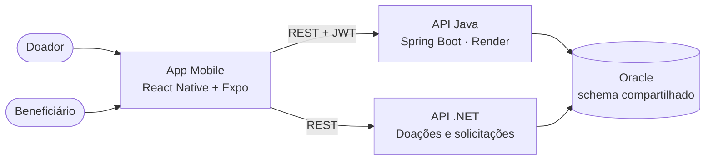

# Partilhaê API

API REST do **Partilhaê**, solução desenvolvida para a **Global Solution 2026/2 (FIAP)**. A plataforma conecta **doadores de alimentos** a **beneficiários**, apoiando o compartilhamento de alimentos e o gerenciamento de contas e denúncias. Esta API implementa autenticação JWT, perfis de usuários e regras de autorização por papel e titularidade.

| | |
|---|---|
| **Aplicação online** | https://partilhae-java.onrender.com |
| **Swagger** | https://partilhae-java.onrender.com/swagger-ui/index.html |
| **Vídeo de apresentação** | *A adicionar* |
| **Disciplina** | Java Advanced (FIAP, 2TDS) |

> O Render (plano gratuito) desliga a aplicação depois de 15 minutos sem uso. A primeira requisição depois disso pode levar alguns segundos enquanto ela volta.

---

## Sumário
1. [O desafio e a nossa proposta](#1-o-desafio-e-a-nossa-proposta)
2. [Integrantes e divisão do trabalho](#2-integrantes-e-divisão-do-trabalho)
3. [Arquitetura da solução](#3-arquitetura-da-solução)
4. [Decisões técnicas](#4-decisões-técnicas)
    - [O que mudou na evolução do projeto](#o-que-mudou-na-evolução-do-projeto)
5. [Segurança: papéis e posse](#5-segurança-papéis-e-posse)
6. [Fluxos funcionais completos](#6-fluxos-funcionais-completos)
7. [Testes automatizados](#7-testes-automatizados)
8. [Integração com as demais disciplinas](#8-integração-com-as-demais-disciplinas)
9. [Como executar](#9-como-executar)
10. [Endpoints](#10-endpoints)
11. [Estrutura do projeto](#11-estrutura-do-projeto)

---

## 1. O desafio e a nossa proposta

### O problema
O desperdício de alimentos e a dificuldade de conectar quem dispõe de excedentes a quem precisa deles representam desafios sociais e logísticos. Uma plataforma integrada pode facilitar essa conexão e organizar os processos de doação e solicitação.

### A proposta do Partilhaê
O **Partilhaê** reúne doadores e beneficiários em um aplicativo, com cadastro de perfis, autenticação e funcionalidades relacionadas a doações e solicitações. O projeto utiliza APIs separadas, integradas pelo aplicativo Mobile e por um banco de dados compartilhado.

### Como esta API contribui para a solução

| Necessidade | Onde é atendida |
|---|---|
| Identificação e acesso | **API Java:** cadastro de doadores e beneficiários, login e JWT |
| Gestão de contas | **API Java:** consulta, atualização e desativação de usuários e perfis |
| Segurança e privacidade | **API Java:** autorização por papel e titularidade, com restrição de dados pessoais |
| Moderação | **API Java:** registro, consulta, atualização de status e resolução de denúncias |
| Doações e solicitações | **API .NET:** funcionalidades próprias de doações e solicitações |
| Interface com o usuário | **Aplicativo Mobile:** integração com as APIs Java e .NET |

---

## 2. Integrantes e divisão do trabalho

| Nome | RM | Turma | Responsabilidade no projeto |
|---|---|---|---|
| Agatha Yie Won Yun | RM561507 | 2TDSA | App mobile (Mobile Application Development) |
| Ana Claudia Fernandes Martins | RM561190 | 2TDSR | Banco de dados (Mastering Relational and Non-Relational Database) e qualidade (Compliance, Quality Assurance & Tests) |
| André Rosa Colombo | RM563112 | 2TDSA | API Java (Java Advanced) |
| Samantha Faruolo Galdi | RM554794 | 2TDSA | API .NET (Advanced Business Development with .NET) e IA (Disruptive Architectures: IoT, IoB & Generative AI) |
| Vitor Fria Dalmagro | RM566052 | 2TDSA | Nuvem/CI-CD (DevOps Tools & Cloud Computing) |

---

## 3. Arquitetura da solução



- **App Mobile:** interface utilizada por doadores e beneficiários; consome os serviços Java e .NET.
- **API Java (este repositório):** autenticação, usuários, doadores, beneficiários e denúncias.
- **API .NET:** operações de doações e solicitações, desenvolvidas separadamente.
- **Banco Oracle:** schema compartilhado entre os serviços, mantido pela equipe de Database.

A API Java pode registrar em denúncias identificadores de doações, conversas ou solicitações, mas **não implementa os respectivos serviços da API .NET**.

### Camadas da API Java

| Camada | Responsabilidade |
|---|---|
| `controller` | Endpoints REST e documentação das operações |
| `service` | Regras de negócio, autorização e titularidade |
| `repository` | Persistência com Spring Data JPA |
| `dto` | Contratos de entrada (`*RequestDTO`) e saída (`*ResponseDTO`) |
| `model` | Entidades JPA e mapeamentos do Oracle |
| `security` | Autenticação JWT, filtros e autorização |
| `exception` | Tratamento centralizado de erros HTTP |
| `config` | Configuração do OpenAPI/Swagger |

---

## 4. Decisões técnicas

- **Perfis de usuário:** doadores e beneficiários possuem registros próprios associados a um usuário; o papel interno `RECEPTOR` foi preservado por compatibilidade com a autorização existente.
- **Rotas públicas padronizadas:** o recurso de beneficiários utiliza `/beneficiarios`, embora a tabela Oracle permaneça `RECEPTOR` e o identificador de resposta continue `idReceptor`.
- **JWT e BCrypt:** login com token Bearer e armazenamento de senhas por hash.
- **Autorização por titularidade:** operações sensíveis verificam se o usuário possui permissão para consultar ou alterar o recurso.
- **`ddl-auto=validate`:** o Oracle é mantido por scripts da equipe de Database. A API valida o schema, sem criá-lo ou modificá-lo automaticamente.
- **Integração desacoplada:** Java e .NET expõem suas próprias rotas; o Mobile consome cada API conforme a funcionalidade.

### O que mudou na evolução do projeto

| Antes | Atualmente | Objetivo |
|---|---|---|
| Classes e rotas de `Receptor` | Classes `Beneficiario` e rotas `/beneficiarios` | Padronizar a integração com o Mobile |
| Controller separado para compatibilidade de cadastro | Cadastro integrado ao `BeneficiarioController` | Evitar duplicidade de endpoints |
| Documentação Swagger desigual entre controllers | Cinco seções com operações, respostas e exemplos documentados | Facilitar testes e integração |
| Referências de schema no código | Mapeamentos preservados para `RECEPTOR`, `id_receptor` e `seq_receptor` | Manter compatibilidade com o Oracle |

### Tecnologias

- Java 25 e Spring Boot 4.1.2
- Spring Web MVC, Spring Security, Spring Data JPA e Hibernate 7
- Oracle Database e driver JDBC Oracle
- JWT (JJWT), BCrypt e Bean Validation
- Springdoc OpenAPI / Swagger UI
- Maven, JUnit 5, Mockito, MockMvc e H2 para testes
- Docker e Render para implantação

---

## 5. Segurança: papéis e posse

A autenticação utiliza **JWT Bearer**. O cadastro de um doador (`POST /doadores`) ou beneficiário (`POST /beneficiarios`) também cria sua conta de usuário. O login ocorre em `POST /auth/login`.

| Papel interno | Permissões principais |
|---|---|
| `ROLE_DOADOR` | Consultar e administrar o próprio perfil, conforme as regras de titularidade |
| `ROLE_RECEPTOR` | Consultar e administrar o próprio perfil de beneficiário, conforme as regras de titularidade |
| `ROLE_ADMIN` | Operações administrativas autorizadas, como listagens e moderação de denúncias |

> **Importante:** `RECEPTOR` permanece como nome do papel interno de segurança e da tabela Oracle. A nomenclatura pública da API é **Beneficiário**. Não existe cadastro público de administradores.

O acesso a informações privadas depende da titularidade ou da permissão administrativa. Consultas públicas de perfil podem omitir dados pessoais e de endereço.

**Rotas públicas:** `POST /doadores`, `POST /beneficiarios`, `POST /auth/login` e documentação Swagger. As demais operações seguem as regras de autenticação e autorização da API.

| Código | Situação documentada |
|---|---|
| `400` | Dados de requisição inválidos |
| `401` | Autenticação ausente ou inválida |
| `403` | Acesso não autorizado para o papel ou titularidade |
| `404` | Recurso não encontrado |
| `409` | Conflito de dados, como cadastro duplicado |
| `500` | Erro interno do servidor |

Os códigos variam conforme a operação; consulte o Swagger para a documentação específica de cada endpoint.

---

## 6. Fluxos funcionais completos

### Fluxo 1: cadastro, login e autenticação

1. `POST /doadores` ou `POST /beneficiarios` cria o usuário e seu perfil.
2. `POST /auth/login` valida as credenciais e retorna o token JWT, o papel e os identificadores pertinentes.
3. O aplicativo envia `Authorization: Bearer <token>` nas operações protegidas.
4. O backend aplica as regras de autorização e titularidade.

### Fluxo 2: gerenciamento de perfis

1. Um usuário autenticado consulta o perfil permitido por `GET /doadores/{id}` ou `GET /beneficiarios/{id}`.
2. A atualização ocorre por `PUT /doadores/{id}` ou `PUT /beneficiarios/{id}`.
3. A exclusão de perfil realiza **desativação lógica** da conta, sem remover fisicamente seus registros.
4. Administradores podem consultar listagens e utilizar filtros específicos de beneficiários.

### Fluxo 3: denúncias e moderação

1. Um usuário autenticado registra uma denúncia por `POST /denuncias`.
2. A denúncia deve apontar para exatamente um alvo: usuário, conversa, solicitação ou doação.
3. Consultas respeitam as permissões do denunciante e do administrador.
4. Um administrador pode alterar o status por `PATCH /denuncias/{id}/status` ou registrar a resolução por `PATCH /denuncias/{id}/resolucao`.

---

## 7. Testes automatizados

A execução de verificação mais recente da refatoração foi relatada com **121 testes aprovados** (`BUILD SUCCESS`). Esse resultado foi informado pela ferramenta de desenvolvimento; execute a suíte novamente para validar o estado do seu checkout.

```bash
./mvnw clean verify
```

No Windows, com Maven instalado, também é possível executar:

```powershell
mvn clean verify
```

Os testes usam o perfil `test` e um banco H2 em memória, sem exigir credenciais do Oracle.

| Tipo | Objetivo |
|---|---|
| **Unitários** | Verificar regras dos services e tratamento de dados |
| **Controllers** (`@WebMvcTest`) | Validar requisições, respostas HTTP e contratos JSON |
| **Integração** | Exercitar autenticação, autorização e contratos do Mobile |
| **Persistência** | Verificar consultas e conversores usados pelos repositories |
| **OpenAPI** | Conferir rotas, tags, parâmetros e requisitos de segurança documentados |

### Testes manuais

O Swagger UI permite testar cadastro, login, consulta e operações protegidas. Após o login, utilize **Authorize** para informar o JWT nas operações que exigem autenticação.

---

## 8. Integração com as demais disciplinas

| Disciplina | Responsável | Evidência |
|---|---|---|
| Java Advanced | **André** | Este repositório e a [API publicada](https://partilhae-java.onrender.com) |
| DevOps Tools & Cloud Computing | **Vitor** | Infraestrutura e atividades de DevOps do projeto; documentação específica a adicionar |
| Advanced Business Development with .NET | **Samantha** | API .NET de doações e solicitações; repositório específico a adicionar |
| Disruptive Architectures: IoT, IoB & Generative AI | **Samantha** | Integração de IA desenvolvida na disciplina; evidência a adicionar |
| Mastering Relational and Non-Relational Database | **Ana Claudia** | Schema Oracle compartilhado, scripts e modelagem de dados |
| Compliance, Quality Assurance & Tests | **Ana Claudia** | Atividades de testes e qualidade; evidência a adicionar |
| Mobile Application Development | **Agatha** | [Aplicativo Partilhaê](https://github.com/Partilhae/Partilhae-APP), em React Native/Expo |

---

## 9. Como executar

### Pré-requisitos

- Java 25
- Maven ou Maven Wrapper
- Acesso ao Oracle da FIAP, com schema compatível com as entidades JPA

### 1. Clonar

```bash
git clone https://github.com/Partilhae/Partilhae_Java.git
cd Partilhae_Java
```

### 2. Variáveis de ambiente

As credenciais e chaves devem ser definidas no ambiente, **nunca incluídas no repositório**.

| Variável | Obrigatória? | Descrição |
|---|---|---|
| `DB_URL` | Em produção | URL JDBC do Oracle; o perfil `dev` pode definir um padrão |
| `DB_USER` | Sim | Usuário Oracle |
| `DB_PASSWORD` | Sim | Senha Oracle |
| `JWT_SECRET` | Na execução normal | Segredo de assinatura do JWT |
| `JWT_EXPIRATION_MS` | Não | Validade do token em ms; padrão `3600000` (1 hora) |
| `SPRING_PROFILES_ACTIVE` | Não | `dev` (padrão), `prod` ou `test` |
| `APP_CORS_ALLOWED_ORIGINS` | Conforme ambiente | Origens autorizadas para requisições CORS |
| `APP_ADMIN_EMAILS` | Para administração | E-mails habilitados para contas administrativas provisionadas |
| `PORT` | Não | Porta HTTP no perfil `prod`; padrão `8080` |

Exemplo em terminal Unix:

```bash
export DB_USER=seu_usuario
export DB_PASSWORD=sua_senha
export JWT_SECRET=sua_chave_secreta_segura
```

### 3. Rodar

```bash
./mvnw spring-boot:run
```

Por padrão, a aplicação é acessada em `http://localhost:8080`, com Swagger em `http://localhost:8080/swagger-ui/index.html`.

### 4. Testar pelo Swagger

1. Cadastre um doador (`POST /doadores`) ou beneficiário (`POST /beneficiarios`).
2. Faça login em `POST /auth/login` e copie o token JWT.
3. Clique em **Authorize** e informe o token, sem o prefixo `Bearer`, se a interface já utilizar o esquema HTTP Bearer.
4. Execute os endpoints permitidos ao papel autenticado.

### Produção (Render)

A aplicação utiliza Docker e o perfil `prod`, com `SPRING_PROFILES_ACTIVE=prod` e variáveis `DB_URL`, `DB_USER`, `DB_PASSWORD` e `JWT_SECRET` configuradas no serviço.

**Aplicação:** https://partilhae-java.onrender.com  
**Swagger:** https://partilhae-java.onrender.com/swagger-ui/index.html

---

## 10. Endpoints

### Autenticação

| Método | Endpoint | Descrição | Acesso |
|---|---|---|---|
| POST | `/auth/login` | Autentica o usuário e retorna o JWT | Público |

### Usuários

| Método | Endpoint | Descrição | Acesso |
|---|---|---|---|
| GET | `/usuarios` | Lista usuários (paginado) | ADMIN |
| GET | `/usuarios/{id}` | Busca usuário por ID | Titular ou ADMIN |
| PUT | `/usuarios/{id}` | Atualiza dados do usuário | Titular ou ADMIN |
| DELETE | `/usuarios/{id}` | Desativa a conta | Titular ou ADMIN |
| PATCH | `/usuarios/{id}/status` | Altera o status da conta | ADMIN |

### Doadores

| Método | Endpoint | Descrição | Acesso |
|---|---|---|---|
| POST | `/doadores` | Cadastra doador e conta de usuário | Público |
| GET | `/doadores` | Lista doadores (paginado) | ADMIN |
| GET | `/doadores/{id}` | Busca doador por ID | Autenticado; dados conforme permissão |
| PUT | `/doadores/{id}` | Atualiza o perfil do doador | Titular ou ADMIN |
| DELETE | `/doadores/{id}` | Desativa a conta do doador | Titular ou ADMIN |

### Beneficiários

| Método | Endpoint | Descrição | Acesso |
|---|---|---|---|
| POST | `/beneficiarios` | Cadastra beneficiário e conta de usuário | Público |
| GET | `/beneficiarios` | Lista beneficiários (paginado) | ADMIN |
| GET | `/beneficiarios/{id}` | Busca beneficiário por ID | Autenticado; dados conforme permissão |
| GET | `/beneficiarios/criancas` | Filtra beneficiários com crianças | ADMIN |
| GET | `/beneficiarios/restricao-alimentar` | Filtra por restrição alimentar | ADMIN |
| PUT | `/beneficiarios/{id}` | Atualiza o perfil do beneficiário | Titular ou ADMIN |
| DELETE | `/beneficiarios/{id}` | Desativa a conta do beneficiário | Titular ou ADMIN |

### Denúncias

| Método | Endpoint | Descrição | Acesso |
|---|---|---|---|
| POST | `/denuncias` | Registra uma denúncia | Autenticado |
| GET | `/denuncias` | Lista denúncias (paginado) | ADMIN |
| GET | `/denuncias/{id}` | Consulta denúncia por ID | Denunciante ou ADMIN |
| GET | `/denuncias/usuario/{id}` | Lista denúncias de um usuário | Titular ou ADMIN |
| PATCH | `/denuncias/{id}/status` | Atualiza o status da denúncia | ADMIN |
| PATCH | `/denuncias/{id}/resolucao` | Registra a resolução | ADMIN |

As listagens paginadas aceitam parâmetros como `?page=0&size=10`. Consulte o Swagger para filtros, schemas e códigos HTTP detalhados.

---

## 11. Estrutura do projeto

```text
src/main/java/br/com/partilhae/partilhae
├── config        => Configuração Swagger/OpenAPI
├── controller    => Endpoints REST
├── dto           => DTOs de requisição e resposta
├── exception     => Exceções e tratamento de erros
├── model         => Entidades JPA
├── repository    => Repositories Spring Data JPA
├── security      => JWT, filtros e autorização
└── service       => Regras de negócio

src/test/java/br/com/partilhae/partilhae
├── controller    => Testes da camada web
├── integration   => Testes de integração e contratos
├── model         => Testes de conversores
├── repository    => Testes de consultas
├── security      => Testes de segurança
├── service       => Testes unitários
└── support       => Dados auxiliares de teste
```

---

Java Advanced · FIAP
